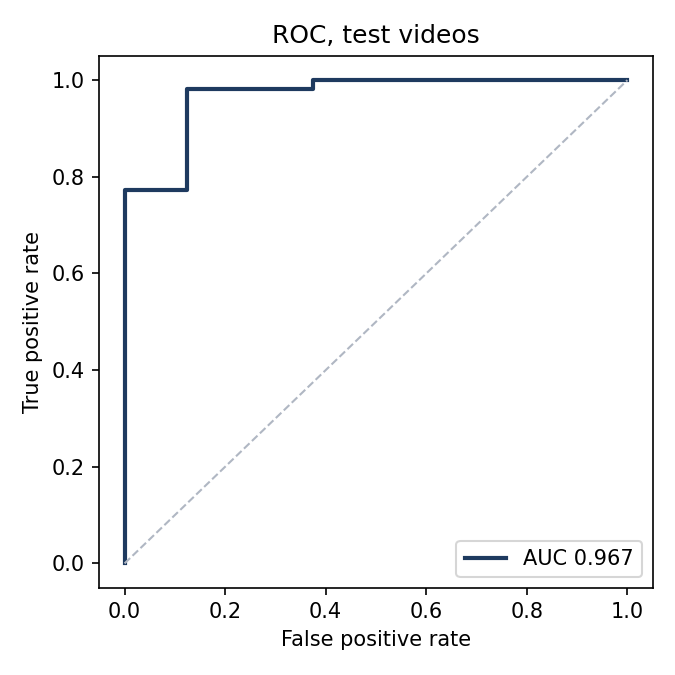
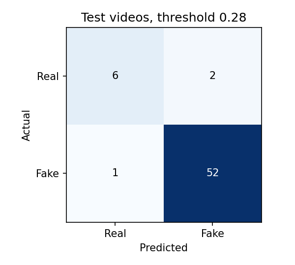

# Results of the Kaggle run

DFDC sample from the Kaggle competition, 400 clips, split by source video (train 278, val 60,
test 62). 16 frames per clip, 6,078 face crops. EfficientNet-B0 from ImageNet weights: 3 epochs
with the backbone frozen, then 12 epochs with the backbone unfrozen from `block6a`. Two T4 GPUs.

One test clip had no face MTCNN could find, so 61 test videos were scored.

## Test set

| | Items | AUC | Log loss | Balanced acc. | Precision (fake) | Recall (fake) | F1 (fake) |
|---|---:|---:|---:|---:|---:|---:|---:|
| Per frame, threshold 0.5 | 976 | 0.939 | 0.350 | 0.871 | 0.977 | 0.883 | 0.928 |
| Per video, threshold 0.5 | 61 | 0.967 | 0.199 | 0.900 | 0.980 | 0.925 | 0.951 |
| Per video, threshold 0.28 (picked on val) | 61 | 0.967 | 0.199 | 0.866 | 0.963 | 0.981 | 0.972 |

Confusion matrix, test videos, threshold 0.28:

| | Predicted real | Predicted fake |
|---|---:|---:|
| Real | 6 | 2 |
| Fake | 1 | 52 |

 

## Training

| Epoch | AUC | Val AUC | Loss | Val loss |
|---:|---:|---:|---:|---:|
| 1 | 0.658 | 0.652 | 0.659 | 0.629 |
| 2 | 0.742 | 0.633 | 0.599 | 0.528 |
| 3 | 0.773 | 0.707 | 0.571 | 0.493 |
| 4 (backbone unfrozen) | 0.847 | 0.810 | 0.483 | 0.455 |
| 5 | 0.934 | 0.861 | 0.326 | 0.330 |
| 6 | 0.970 | 0.915 | 0.219 | 0.284 |
| 7 | 0.981 | 0.916 | 0.173 | 0.300 |
| 8 | 0.990 | 0.905 | 0.128 | 0.365 |
| 9 | 0.990 | 0.930 | 0.121 | 0.392 |
| 10 | 0.992 | 0.929 | 0.104 | 0.282 |
| 11 | 0.994 | 0.946 | 0.094 | 0.375 |
| 12 | 0.995 | 0.925 | 0.089 | 0.302 |
| 13 | 0.996 | 0.937 | 0.081 | 0.302 |
| 14 | 0.997 | 0.932 | 0.063 | 0.304 |
| 15 | 0.997 | 0.927 | 0.073 | 0.292 |

The checkpoint with the best validation AUC (epoch 11) is the one evaluated. Training AUC keeps
rising while validation AUC levels off around 0.93, so more data would help more than more epochs.
